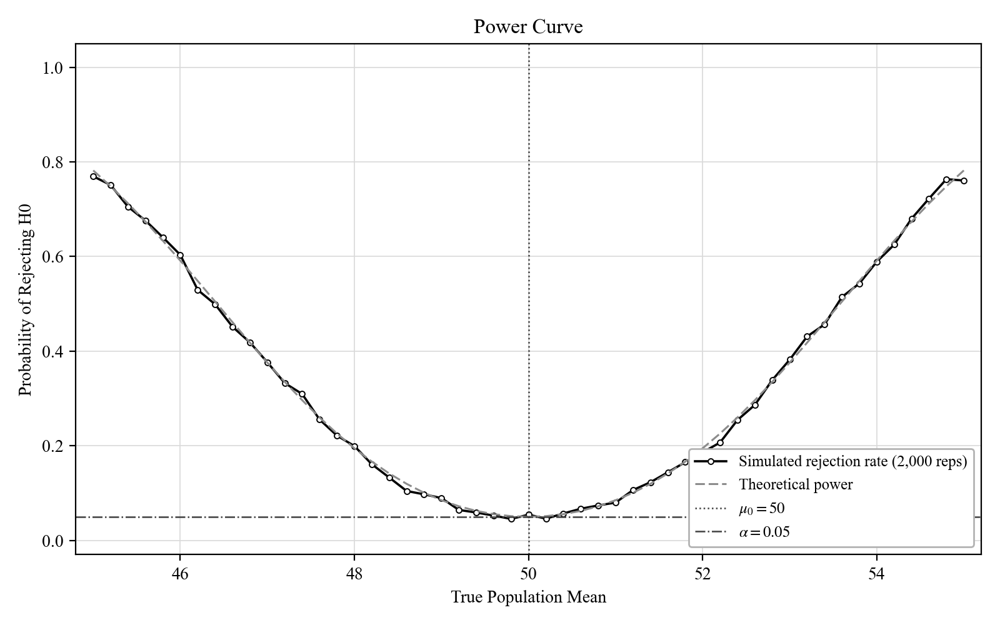

# Homework 4 — Hypothesis Testing, MLE, and Power Analysis

**Orlando Leng**

Code and figures for Homework 4. Part 1 is analytical (written up in the submitted
PDF); the scripts here reproduce every number in it and generate the figures.
Part 2 is the simulation exercise.

## Files

| File | What it does |
|---|---|
| `hw4_part2_simulation.py` | Part 2 coding problem: Type I error simulation (A), Type II error and power across sample sizes (B), and the power curve (C) with its plot. |
| `hw4_part1_analysis.py` | Numerical verification of the Part 1 answers, plus the figures used in the write-up. |
| `figures/` | All generated figures (`.png` and `.pdf`). |

## Running

```bash
pip install numpy scipy matplotlib
python hw4_part1_analysis.py
python hw4_part2_simulation.py
```

Both scripts use `np.random.seed(42)` / `default_rng(42)`, so the printed numbers
are reproducible.

## Results

### Part 1 (analytical)

| Problem | Answer |
|---|---|
| 1a  P(return < 0) | 0.3745 |
| 1b  P(−1% < return < 3%) | 0.5748 |
| 1c  P(return > 4%) | 0.1003 |
| 1d  10th percentile | −2.404% |
| 2d  MLE of λ | 10 / 13.6 = 0.7353 per second |
| 3c  n per group, 8% → 10% | 2,526 |
| 3d  n per group, 8% → 9% | 9,603 |

### Part 2A — empirical Type I error rate

10,000 simulations, n = 30, two-sided z-test at α = 0.05:

| | |
|---|---|
| rejections | 548 / 10,000 |
| empirical Type I error | 0.0548 |
| theoretical α | 0.0500 |
| Monte Carlo standard error | 0.0022 |

The simulated rate sits about 2.2 Monte Carlo standard errors above 0.05. That is
sampling variation in this particular seed, not a bias in the procedure: averaged
over 40 independent runs of the same code the rate is 0.05001, with a spread
(0.00196) matching the theoretical Monte Carlo standard error (0.00218).

### Part 2B — Type II error and power (true μ = 53, H₁: μ > 50)

| Sample size | β | Power | Power (theory) |
|---:|---:|---:|---:|
| 30 | 0.5036 | 0.4964 | 0.4993 |
| 60 | 0.2471 | 0.7529 | 0.7514 |
| 120 | 0.0507 | 0.9493 | 0.9497 |

### Part 2C — power curve

Rejection rate at the null value μ = 50 is 0.0545, which recovers α as it should.
Power rises symmetrically as the true mean moves away from 50 in either direction.


